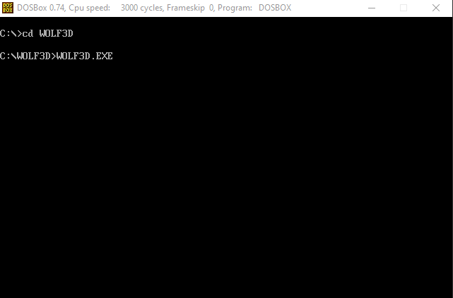

# Wolf2Shell

**Wolf2Shell is an arbitrary code execution exploit for id Software's _Wolfenstein 3D_ (1992, DOS).** A crafted savegame causes the game to run attacker-supplied shellcode embedded in the save file, yielding control of the DOS machine. It abuses the save loader's failure to validate actor state pointers during deserialization; the payload executes in 16-bit real mode, where save data is loaded into executable memory.

(Tested against GOG's `setup_wolfenstein_3d_1.4_(28045).exe`)

## Vulnerability

| | |
| --- | --- |
| **Class** | Insecure deserialization of untrusted data → control-flow hijack → arbitrary code execution (CWE-502 / CWE-94) |
| **Impact** | Arbitrary code execution in the game's DOS session |
| **Vector** | Crafted `SAVEGAM*.WL6` loaded through the in-game **Load Game** menu |
| **Affected** | Retail Wolfenstein 3D (DOS, 16-bit real mode): save loading in `WL_MAIN.C`, actor dispatch in `WL_PLAY.C`, structures in `WL_DEF.H` |

Wolf3D savegames serialize actor objects (`objtype`) directly, including the `state` pointer used by the AI update loop. The loader does not validate that pointer, and the object records are not covered by the save checksum. On the next AI tick, `DoActor()` executes `ob->state->think(ob)` — an indirect far call through save-controlled data. Wolf2Shell points `state` at a fake `statetype` embedded in the same object bytes and sets its `think` field to shellcode also stored in the save, so execution jumps into attacker code as soon as the save loads. The key environment-specific requirement is the runtime DGROUP segment the save data lands in (`DGROUP = PSP + 0x10 + 0x398D`; the delta is build-specific, and `PROBE.COM` measures the PSP). The tool rebuilds the save structure and recomputes the checksum so the game accepts the modified file.

## Documentation

- [`TECHNICAL_INFO.md`](TECHNICAL_INFO.md) — consolidated structures, save layout, DGROUP/PSP arithmetic, and the injection layout.
- [`HURDLES.md`](HURDLES.md) — technical obstacles to reliable execution and their status (including portability to other builds).
- [`SHAREWARE.md`](SHAREWARE.md) — shareware (`.WL1`) port: derived build constants and status.
- [`tools/make-save/README.md`](tools/make-save/README.md) — builder usage, options, and save layout.
- [`tools/probe/README.md`](tools/probe/README.md) — measuring the DOS PSP segment.

## Supported builds

`make-save.py --version` selects the target:

| Version | Extension | `DGROUP_REL` | `objlist` | `tilemap` |
| --- | --- | ---: | ---: | ---: |
| `retail` | `.WL6` | `0x398D` | `0xB51C` | `0x75BA` |
| `shareware` | `.WL1` | `0x3783` | `0xAB6E` | `0x6BD8` |

## Payloads

Wolf2Shell supports three payload modes:

- **`reboot`** — Triggers a warm reboot payload.
- **`text`** — Switches to text mode, displays a custom message, waits for a key, then exits to DOS.
- **`asm`** — Assembles and injects a custom 16-bit NASM payload. Two
  ready-made sources ship in `tools/make-save/`: `wolf2shell.asm` (the VGA
  plasma / sine-scroller / PC-speaker demo) and `calc.asm` (an interactive
  on-screen calculator).

## Savegames

The ready-made saves live in [`savegames/`](savegames/) — `.WL6` files for
retail, `.WL1` files for shareware (the three built-in payloads plus the
`calc.asm` calculator, different build constants):

| Savegame file | Game version | In-game name | What it does |
| --- | --- | --- | --- |
| [SAVEGAM0.WL6](savegames/SAVEGAM0.WL6) | Retail | Reboot! | Injects a two-byte `INT 19h` payload: loading the save warm-reboots the DOS machine. |
| [SAVEGAM1.WL6](savegames/SAVEGAM1.WL6) | Retail | Text + Shell | Injects a text-mode payload that prints the configured message (default "Wolf2Shell by Hypn"), waits for a key, then exits to DOS. |
| [SAVEGAM2.WL6](savegames/SAVEGAM2.WL6) | Retail | ASM payload! | Injects the assembled `wolf2shell.asm` payload: a VGA plasma, sine-wave scroller and PC-speaker demo. It does not return to DOS (the game's keyboard ISR swallows the exit key). |
| [SAVEGAM3.WL6](savegames/SAVEGAM3.WL6) | Retail | Calculator | Injects the assembled `calc.asm` payload: an interactive VGA calculator (numpad/top-row digits, `+ - * /`, Enter to evaluate, `C` to clear, Backspace, Esc to exit to DOS). |
| [SAVEGAM0.WL1](savegames/SAVEGAM0.WL1) | Shareware | Reboot! | Same as above, for the shareware build. |
| [SAVEGAM1.WL1](savegames/SAVEGAM1.WL1) | Shareware | Text + Shell | Same as above, for the shareware build. |
| [SAVEGAM2.WL1](savegames/SAVEGAM2.WL1) | Shareware | ASM payload! | Same as above, for the shareware build. |
| [SAVEGAM3.WL1](savegames/SAVEGAM3.WL1) | Shareware | Calculator | Same as above, for the shareware build. |

### Playing the saves

These saves are for the matching Wolf3D build (retail `.WL6` or shareware
`.WL1`) running under DOSBox:

1. See [`tools/probe/`](tools/probe/README.md) to get the **PSP segment** for your DOS session. Run `PROBE.COM` immediately before `WOLF3D.EXE`, then read `PROBE.TXT`. If it differs from the default `0192`, rebuild the saves with `python3 tools/make-save/make-save.py --psp <hex> ...` (add `--version shareware` for the `.WL1` set) first.
2. Copy the matching `SAVEGAM0`–`SAVEGAM3` files (`.WL6` for retail, `.WL1` for shareware) from `savegames/` into your Wolf3D directory, next to `WOLF3D.EXE`.
3. Start the game under DOSBox from that directory (mount it, then run `WOLF3D.EXE`).
4. Choose **Load Game** in the main menu and select the slot with the matching in-game name (`Reboot!`, `Text + Shell`, `ASM payload!`, or `Calculator`). The payload runs as soon as the save loads: `Reboot!` reboots the machine, `Text + Shell` prints its message and waits for a key before returning to DOS, `ASM payload!` runs the demo (it does not return to DOS), and `Calculator` draws an interactive calculator that returns to DOS on `Esc`.

## Tools

- [`tools/make-save/`](tools/make-save/README.md) — the savegame builder (`make-save.py`), its base save, the demo and calculator payload sources, and full usage/options documentation.
- [`tools/probe/`](tools/probe/README.md) — `PROBE.COM`, the helper that measures the DOS PSP segment.
