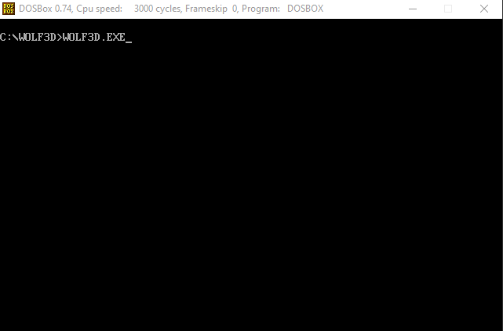
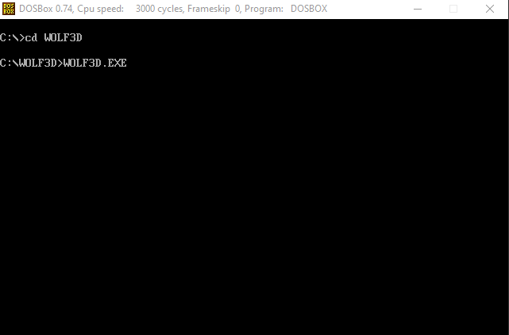

# Wolf2Shell

*by Hypn*

_A critical flaw present in a popular FPS game, present for over 30 years! Code execution by opening a malicious save game file!_

This was going to be a satire/troll project, until (A)I found actual code injection in Wolf3D savegame files :P

## Overview

Wolf3D savegames store game objects, including state pointers used by the actor update loop. By crafting a save file with a controlled object state, execution can be redirected to payload data embedded in the save.

## Savegames

The ready-made saves live in [`savegames/`](savegames/):

| Savegame file | In-game name | What it does |
| --- | --- | --- |
| `savegames/SAVEGAM0.WL6` | Reboot! | Injects a two-byte `INT 19h` payload: loading the save warm-reboots the DOS machine. |
| `savegames/SAVEGAM1.WL6` | Text + Shell | Injects a text-mode payload that prints the configured message (default "Wolf2Shell by Hypn"), waits for a key, then exits to DOS. |
| `savegames/SAVEGAM2.WL6` | ASM payload! | Injects the assembled `wolf2shell.asm` payload: a VGA plasma, sine-wave scroller and PC-speaker demo; press a key to exit to DOS. |

### Playing the saves

These saves are for **retail Wolf3D running under DOSBox**:

1. Copy the `SAVEGAM0.WL6`, `SAVEGAM1.WL6` and `SAVEGAM2.WL6` files from `savegames/` into your Retail Wolf3D directory, next to `WOLF3D.EXE`.
2. Start the game under DOSBox from that directory (mount it, then run `WOLF3D.EXE`).
3. Choose **Load Game** in the main menu and select the slot with the matching in-game name (`Reboot!`, `Text + Shell`, or `ASM payload!`). The payload runs as soon as the save loads; the first one reboots, the other two wait for a key press before returning to DOS.


### Demos

**Payload #1: Triggering a reboot**


**Payload #2: Shell + text ouput**


**Payload #3: Demoscene ASM**


---

# The "make-save.py" tool
The tool rebuilds the save structure and recalculates the required checksum so the game accepts the modified file.

Wolf2Shell is a tool for generating Wolfenstein 3D savegame files with injected payloads. It demonstrates how crafted save data can influence in-game execution by manipulating object state pointers during save loading.


## Payloads

Wolf2Shell supports three payload modes:

- **`reboot`** — Triggers a warm reboot payload.
- **`text`** — Displays a custom text message in DOS.
- **`asm`** — Assembles and injects a custom 16-bit NASM payload.

## Usage

```bash
python3 make-save.py --slot 0 --payload reboot
python3 make-save.py --slot 1 --payload text --text "Wolf2Shell by Hypn"
python3 make-save.py --slot 2 --payload asm --asm wolf2shell.asm
```

### Options

```text
(required)
  --payload {asm,reboot,text}   Payload type
  --text TEXT                   Text for --payload text (default: "Wolf2Shell by Hypn")
  --asm ASM                     ASM file for --payload asm (default: wolf2shell.asm)

(defaults)
  --name NAME                   In-game save name (default: Wolf2Shell)
  --version {retail}            Game version (default: retail)
  --psp PSP                     Wolf3d.exe PSP segment in hex (default: 0192)
  --outdir OUTDIR               Output directory (default: savegames)

(advanced)
  --dgroup DGROUP               Override runtime DGROUP segment directly
  --dgroup-rel DGROUP_REL       Override DGROUP delta (DGROUP = PSP+0x10+DGROUP_REL)
  --objlist-off OBJLIST_OFF     DGROUP-relative objlist offset (default 0xb51c)
  --tilemap-off TILEMAP_OFF     DGROUP-relative tilemap offset (default 0x75ba)
  --nasm NASM                   NASM executable (default: nasm)
```

## Notes

- Generated files are written as `SAVEGAM{slot}.WL6` into `savegames/` by default; use `--outdir` to write somewhere else.
- `--name` sets the in-game save name stored in the save header.
- `text` and `asm` payloads require [NASM](https://www.nasm.us/) to be available.
- The `asm` payload supports the `__PAYLOAD_ORG__` placeholder for the selected tilemap injection offset.
- Runtime segment values can vary by DOS environment; use `--psp`, `--dgroup-rel`, or `--dgroup` if the defaults do not match your setup.
- See the [`probe/`](probe/README.md) directory to get the **PSP segment** for your DOS session. Run `PROBE.COM` immediately before `WOLF3D.EXE`, then read `PROBE.TXT`. If it differs from the default `0192`, rebuild the saves with `python3 make-save.py --psp <hex> ...` first.
